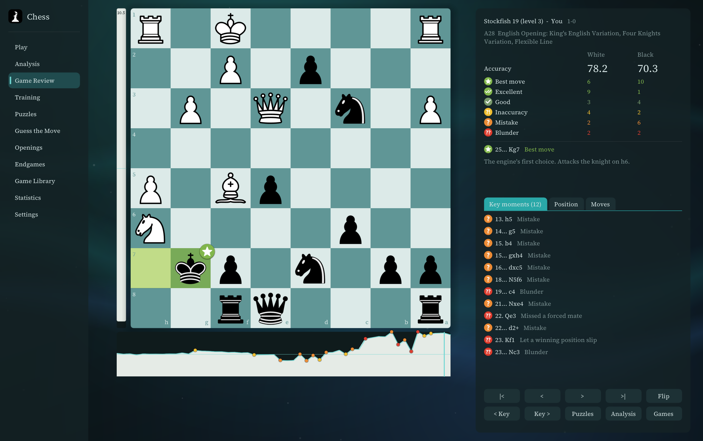

# Chess - A simple, no clutter chess engine to practice



A native, offline chess app for Windows and macOS. Play against Stockfish, analyse your
games, train with puzzles, opening repertoires and endgames, and find out which mistakes you
keep making. Everything runs on your machine: no account, no server, no ads.

## Features

### Play

Play Stockfish as White or Black at 8 levels or a chosen Elo, from the start position or any
FEN, with time controls from bullet to classical. The board supports drag and drop or click to
move, legal move hints, the full rules (castling, en passant, promotion and every draw
rule), undo and redo, and sounds.

While you play you can turn on:

- **Move badges**: every move is judged as it is played (best, excellent, good, inaccuracy,
  mistake, blunder).
- **Coach mode**: after a mistake the computer pauses, shows the stronger move and offers a
  take-back. The clocks stop while it talks.
- **Opening practice**: pick a named opening or one of your repertoires and the computer
  answers from it, telling you when you leave the book.
- **Hints**: H marks the piece Stockfish would move; press again for the move itself.
- **Blindfold mode**: the pieces are hidden and you play from the move list (B toggles it,
  hold Space to peek).

### Analysis

- Live engine analysis with up to 5 lines, an evaluation bar and a best-move arrow.
- A game tree with nested variations and comments; promote, reorder or delete lines.
- One-click full-game analysis with an evaluation graph and move classification.
- FEN and PGN import and export, including variations, comments, glyphs and `[%eval]`.
- An opening explorer built from your own game library.
- Board overlays for square control, pieces that can be won and piece activity.
- A second UCI engine for side-by-side comparison, and Syzygy endgame tablebase support.
- Arrows and square marks with the right mouse button.

### Game Review

The engine checks every move of a game in the background and gives you accuracy for both
players, a classification for each move and a list of key moments (mistakes, blunders, missed
wins and mates). Weak moves show what you played next to what the engine preferred, with a
short rule-based explanation of what each move attacks, allows or misses.

Reviewed games can be turned into puzzles: each critical moment where a mistake could be
punished becomes a verified, unambiguous puzzle under the theme "From my games". Reviews are
stored with the game, so reopening one needs no engine.

### Training

- **Puzzles**: about 4,800 Lichess puzzles built in, with the full Lichess database importable
  from CSV. A personal rating, themes, a daily puzzle, streaks and spaced repetition for
  missed puzzles.
- **Openings**: build repertoires for White and Black by playing moves or importing PGN, then
  drill them with spaced repetition. Three starter repertoires are included.
- **Endgames**: 16 engine-checked positions, from basic mates to rook and queen endings,
  played against Stockfish at full strength.
- **Guess the Move**: replay a master game (six classics bundled, or any of your own) and
  score points for finding the moves.
- **Weaknesses**: every mistake in your reviewed games is checked for the tactic you missed
  or allowed ("missed a fork", "got pinned", "left a piece hanging"). Patterns are ranked with
  tips, examples and buttons to practise them.
- **Mistake drill**: the positions where you went wrong, served back on a spaced schedule.
- **Dashboard**: blunders per game, centipawn loss, puzzle and endgame success, results per
  engine level, mistakes per game phase and what is due today.

### Library and statistics

- Finished games are saved automatically to a local game library you can search, filter,
  import into and export from.
- Statistics from your reviewed games: results, accuracy overall, per colour, per game phase
  and per opening, plus time spent in the app, a day streak and a year calendar. Add the names
  you use on other sites in Statistics to include imported games.
- A home page with your streak, puzzle rating, recent results, a weekly chart, a tip of the
  day and shortcuts to what is due.

### Look and feel

Fourteen colour themes (nine dark, five light) with matching boards, the Source Serif 4 font,
an optional animated background, fullscreen (F11), custom sound effects and optional Discord
Rich Presence ("Playing Stockfish (level 3) - Move 12").

## Shortcuts

| Key | Action |
| --- | --- |
| Left / Right | Play: undo / redo. Analysis and Game Review: previous / next move |
| Up / Down | Analysis: switch between variations. Game Review: previous / next key moment |
| Home / End | Analysis and Game Review: start / end of the line |
| Ctrl+V | Analysis: paste a FEN or PGN |
| F | Flip the board |
| H | Play: hint (first the piece, then the move) |
| F11 | Fullscreen on / off |
| B / hold Space | Play and Puzzles: blindfold on / off, peek at the pieces |
| Ctrl+N | New game |
| Right click / right drag | Mark a square / draw an arrow (a left click clears them) |

## Building

Requirements: [xmake](https://xmake.io) and a C++20 compiler (Visual Studio with the C++
workload on Windows, Xcode command line tools on macOS). Dependencies (SFML 3, Dear ImGui,
ImGui-SFML, nanosvg, SQLite, doctest) are downloaded by xmake.

```
xmake f -m release
xmake build chess
xmake run chess
```

Run the unit tests with `xmake build tests` and `xmake run tests`.

Windows and macOS are built and tested. The Linux build shares the macOS code paths but has
not been compiled or run.

### Engine

The app looks for an executable whose name starts with `stockfish` anywhere inside an
`engines/` folder next to the executable or in one of its parent folders. Download a build
from <https://stockfishchess.org/download/> and unpack it there, or set a path to any UCI
engine in Settings. The `engines/` folder is not committed.

`xmake build ucicheck` builds a small console tool that starts an engine and asks it for a
move: `xmake run ucicheck <path-to-engine>`.

### Releases

`python3 tools/package_release.py` builds the release version, bundles the first Stockfish
executable in `engines/` (or `--engine <path>`) with its license and a `SOURCE.txt` pointing
to its exact source, as the GPL requires, and writes to `release/`:

- Windows and Linux: `Chess-<version>-<platform>.zip` with the program, `data/` and `engines/`.
- macOS: `Chess-<version>-macos-arm64.dmg` with `Chess.app` (Apple Silicon, macOS 13 or
  later). The app is signed ad hoc, so on another Mac the first launch needs System Settings >
  Privacy & Security > "Open Anyway". Pass `--sign "Developer ID Application: Name (TEAMID)"`
  and `--notarize <profile>` to produce an app that opens without that step.

### User data

Settings (`settings.ini`) and the SQLite database (`games.db`) with your games, reviews,
puzzles and repertoires live in:

- Windows: `%APPDATA%\ChessDesktop`
- macOS: `~/Library/Application Support/ChessDesktop`
- Linux: `~/.local/share/ChessDesktop`

## Layout

| Path | Contents |
| --- | --- |
| `src/chess` | Rules, game tree, PGN, move classification, review, statistics, position facts, move explanations, puzzles, repertoires, endgames, weakness detection. No UI or engine dependencies. |
| `src/platform` | Everything operating-system specific: child processes, user folders, file dialogs, local connections (Discord), high-DPI windows, live resize. Windows and POSIX implementations, plus a few macOS-only parts. |
| `src/engine` | The asynchronous UCI client. |
| `src/storage` | SQLite stores for games, reviews, puzzles, repertoires and training progress. |
| `src/app` | Window, main loop, settings, themes, assets, background analysis, puzzle generation, the comparison engine, Discord presence. |
| `src/ui` | Board view, move tree view and one screen per section. |
| `tests` | Unit tests for the rules, PGN, classification, review, statistics, puzzles, spaced repetition, the opening book, the UCI parser and the stores. |
| `tools` | `ucicheck`, the release packager and `make_badges.py` (regenerates the move badges; needs Python with Pillow). |
| `third_party/chess` | [chess-library](https://github.com/Disservin/chess-library) by Disservin (MIT). |
| `data` | Pieces, sounds, font, opening names, starter puzzles and repertoires, classic games. Opening tables and puzzles from [Lichess](https://database.lichess.org) (CC0); cburnett pieces by Colin M.L. Burnett (GPLv2+) from [lila](https://github.com/lichess-org/lila); sounds from [Kenney](https://kenney.nl) (CC0). |

## AI notice

This project was developed with substantial help from AI coding assistants (Claude, by
Anthropic). A large part of the code, tests and documentation was generated by AI and then
reviewed, tested and directed by a human. Bugs and odd design choices are still possible; issue
reports are welcome.

The chess engine is [Stockfish](https://stockfishchess.org), a separate project that is
downloaded or bundled, not part of this repository.

## License

Copyright (C) 2026 Moonscorched Productions.

This program is free software: you can redistribute it and/or modify it under the terms of the
GNU General Public License as published by the Free Software Foundation, either version 3 of the
License, or (at your option) any later version. See `LICENSE`.

Third-party code, data and assets keep their own licenses; see `THIRD_PARTY_NOTICES.md`.
